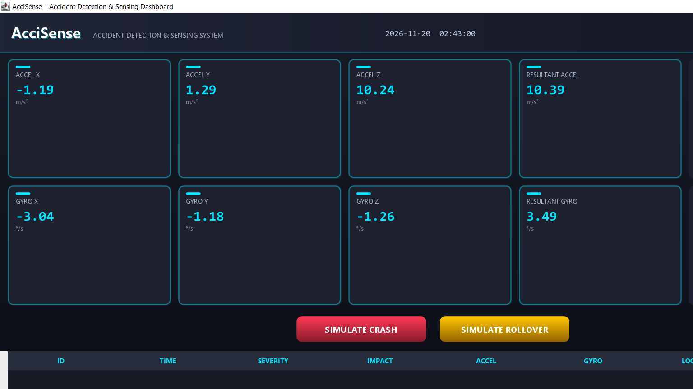
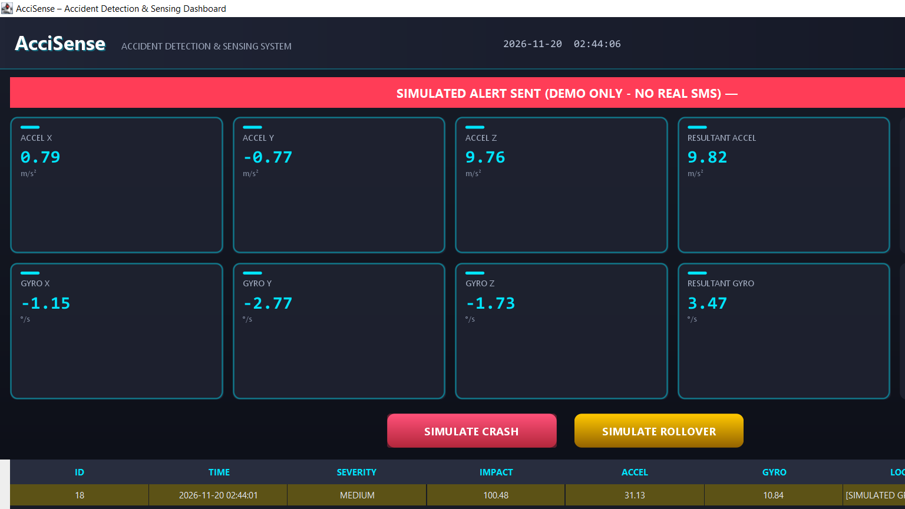
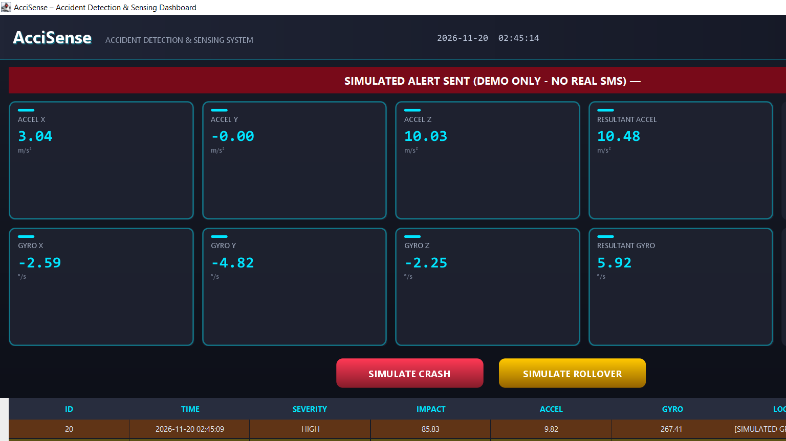
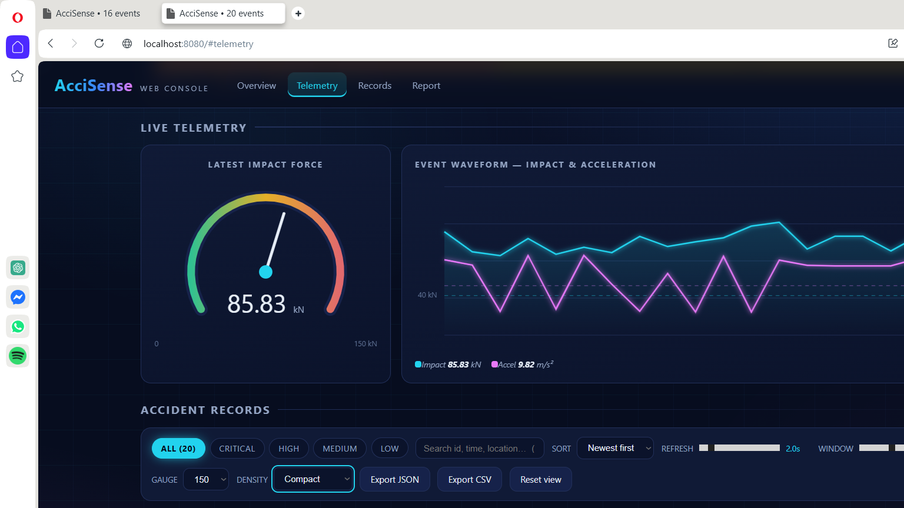

# 🚗 AcciSense — Accident Detection & Sensing System

**Real-time accident detection in pure Java** — simulated vehicle sensors, 2-of-3
threshold confirmation, severity classification, sound + simulated SMS alerts,
SQLite persistence via JDBC, an animated Swing dashboard, **and a servlet-based
web console** served by embedded Tomcat against the same database.


> ⚠️ **Simulation notice:** all sensor data, GPS locations and SMS notifications in
> this project are **simulated for academic demonstration**. No real emergency
> service is contacted and no real hardware is required.

---

## 🎯 At a Glance

| | |
|---|---|
| **University** | Galgotias University |
| **Course** | B.Tech CSE (AI & ML) — Java Project, Review 2 |
| **Category** | Java GUI Based (Swing) + Servlet Web Layer |
| **Team** | **Arshan Khan** (Leader) · Dhruv Pandey · Kush Mishra · Kartik |
| **Repository** | https://github.com/arshankhan1346/Accisense |
| **Runtime** | JDK 17+ · all jars bundled in `lib/` |

### Contents
[Problem](#-problem-statement) · [Solution](#-proposed-solution) ·
[Architecture](#-architecture) · [Screenshots](#-screenshots) ·
[Detection Algorithm](#-detection-algorithm) · [Database](#-database-design) ·
[JDBC](#-jdbc-connectivity) · [Servlets](#-servlet-web-layer) ·
[UI/UX](#-uiux--responsiveness) · [Concurrency](#-concurrency--thread-safety) ·
[Structure](#-project-structure) · [Rubric](#-rubric-coverage) ·
[Testing](#-testing--results) · [Run](#-how-to-run) · [Team](#-team)

---

## 📌 Problem Statement

Road traffic accidents kill approximately **1.35 million people worldwide every
year** (WHO). The decisive factor is not the crash itself but the **delay in
emergency response**: survival rates rise **60–70%** when help arrives within the
**Golden Hour** (first 60 minutes).

After an accident — especially on highways or in remote areas — there is often
**no one to report the crash**: the victim may be unconscious and no witnesses
may be present.

| # | Existing approach | Limitation |
|---|---|---|
| 1 | Manual call by victim / bystander | Fails if victim is unconscious |
| 2 | Airbag sensors | Deploy airbags but notify nobody outside the vehicle |
| 3 | GPS fleet trackers | Track location, cannot detect a collision |
| 4 | Smartphone apps | Phone may be unmounted or thrown during impact |
| 5 | Insurance telematics | Analyse data after the fact, not in real time |

**Result: preventable deaths caused by late detection and late reporting.**

---

## 💡 Proposed Solution

AcciSense **removes the human from the detection loop**:

1. **SENSE** — accelerometer, gyroscope and impact sensors stream every 500 ms
2. **DETECT** — 2-of-3 threshold confirmation eliminates false alarms
3. **CLASSIFY** — weighted severity score → LOW / MEDIUM / HIGH / CRITICAL
4. **ALERT** — audible beep + clearly-labelled simulated SMS on a background executor
5. **PERSIST** — every event stored in SQLite via JDBC with its original timestamp
6. **VISUALIZE** — animated Swing HUD **and** a live browser console (servlets)

| Existing limitation | AcciSense answer |
|---|---|
| Needs a conscious human | Fully automatic detection & alerting |
| No external notification | Sound + simulated SMS pipeline |
| No severity information | 4-level severity classification |
| Post-fact analysis only | Real-time streaming analysis (500 ms cycle) |
| No monitoring view | Swing dashboard + servlet web console |

---

## 🏗️ Architecture

Event-driven **Observer pattern** — every module communicates through listener
interfaces, so components stay fully decoupled and replaceable.

```
┌───────────────┐    ┌────────────────┐    ┌──────────────┐
│ SENSOR        │───►│ ACCIDENT       │───►│ ALERT        │
│ SIMULATOR     │    │ DETECTOR       │    │ MANAGER      │
│ (Runnable,    │    │ (2-of-3 logic, │    │ (Executor-   │
│  AtomicBoolean)│   │  HashMap)      │    │  Service)    │
└───────────────┘    └────────────────┘    └──────┬───────┘
                                                  │
                              ┌───────────────────┼───────────────────┐
                              ▼                   ▼                   ▼
                      ┌──────────────┐   ┌──────────────┐   ┌────────────────┐
                      │ DATABASE     │   │ SWING        │   │ SERVLET LAYER  │
                      │ MANAGER      │   │ DASHBOARD    │   │ (Tomcat, JSON  │
                      │ (JDBC/SQLite)│   │ (custom HUD) │   │  API + console)│
                      └──────────────┘   └──────────────┘   └────────────────┘
```

Interfaces: `SensorListener` · `AccidentListener` · `AlertListener`

---

## 🖼️ Screenshots

| 🖥️ Swing dashboard (live telemetry) | 🚨 Crash detection & alert |
|---|---|
|  |  |

| 💾 SQLite accident log (Swing table) | 🌐 Servlet web console (localhost:8080) |
|---|---|
|  |  |

The Swing app and the browser console share **one SQLite database** — a crash
simulated on the desktop appears in the browser within one poll cycle.

---

## 🧠 Detection Algorithm

```
Triggers (any 2 of 3 confirm an accident):
  impact_force      >  40 kN
  accel_resultant   >  20 m/s²
  gyro_resultant    > 120 °/s

Severity score = impact × 0.5 + accel × 1.5 + gyro × 0.3
  > 200 → CRITICAL   > 120 → HIGH   > 70 → MEDIUM   else → LOW

Cooldown: 5 s per event (prevents duplicate alerts/rows)
```

Why 2-of-3? Hard braking spikes acceleration only (no alert). A real collision
spikes impact **and** acceleration together (confirmed). Rollovers spike gyro
**and** impact. One signal is never enough — false positives are designed out.

---

## 🗄️ Database Design

Embedded **SQLite** (`accisense.db`, auto-created on first run): zero-config,
single-file, ideal for an in-vehicle edge device. Standard JDBC means swapping
to MySQL/PostgreSQL requires changing only the URL and driver class.

**Table `accidents`**

| Column | Type | Constraints | Meaning |
|---|---|---|---|
| `id` | INTEGER | PK AUTOINCREMENT | event id |
| `timestamp` | TEXT | NOT NULL | detection time — preserved on re-read |
| `severity` | TEXT | NOT NULL | LOW / MEDIUM / HIGH / CRITICAL |
| `impact_force` | REAL | NOT NULL | kN |
| `accel_resultant` | REAL | NOT NULL | m/s² |
| `gyro_resultant` | REAL | NOT NULL | °/s |
| `location` | TEXT | – | simulated GPS, explicitly tagged |
| `alert_sent` | INTEGER | DEFAULT 0 | 1 = simulated alert fired |

Design notes: timestamps are captured **once at detection** and restored on
every read (historical data never drifts); ordering uses the monotonic `id`
so ties can never reorder history.

---

## 🔌 JDBC Connectivity

`Class.forName("org.sqlite.JDBC")` → `DriverManager.getConnection` →
`PreparedStatement` (parameterised, injection-safe) → `ResultSet` row mapping →
**try-with-resources** for automatic closing.

- **Failures propagate**: read/write errors throw `DatabaseException` to callers
  (the servlet layer answers HTTP 500). Nothing is silently swallowed.
- **Shared-connection safety**: every public method is `synchronized` because the
  alert worker thread and servlet threads use one connection.
- **Full CRUD** in `DatabaseManager`: CREATE table, INSERT (+generated keys),
  SELECT all / by severity, COUNT, DELETE, CLOSE.

---

## 🌐 Servlet Web Layer

Embedded **Tomcat** (`tomcat-embed-core`) boots beside the Swing GUI, on the first
free port (8080→8089), self-tests over HTTP, then opens the browser automatically.

| Endpoint | Method | Servlet | Purpose |
|---|---|---|---|
| `/` | GET | `WebDashboardServlet` | live browser HUD (stats, gauge, waveform, sortable table, filters, CSV/JSON export, detail drawer) |
| `/api/accidents` | GET | `AccidentApiServlet` | JSON list, optional `?severity=HIGH` filter |
| `/api/accidents` | POST | `AccidentApiServlet` | manual accident report via form parameters |
| `/api/stats` | GET | `StatsApiServlet` | JSON severity statistics (`EnumMap` + `merge`) |

Servlet features: `doGet`/`doPost`, request parameters, proper HTTP status codes
(200/400/500), JSON built server-side, `Cache-Control: no-store`.

---

## 🎨 UI/UX & Responsiveness

- **Dark automotive HUD palette** (navy `#0b132b`, cyan/red severity accents) —
  reduces eye strain for 24/7 monitoring and makes alerts pop peripherally
- **Custom `paintComponent` rendering**: glowing sensor cards, animated impact
  gauge with interpolating needle, scrolling acceleration waveform
- **Severity colour coding** everywhere (table rows, chips, distribution bar)
- **Flashing alert banner explicitly labelled DEMO ONLY**
- **EDT discipline**: all Swing updates via `SwingUtilities.invokeLater`; blocking
  work (audio, DB, SMS) never touches the Event Dispatch Thread
- **Web console responsiveness**: CSS grid reflows 5→2 columns under 980 px,
  sticky control bar, sortable/filterable/searchable table, density toggle

---

## 🧵 Concurrency & Thread Safety

| Technique | Where | Why |
|---|---|---|
| `AtomicBoolean` + `getAndSet(false)` | `SensorSimulator` state flags | lock-free, atomic read-and-reset |
| Daemon `Runnable` thread | sensor stream | background sampling, clean exit |
| `ExecutorService` | `AlertManager` | sound/SMS/DB never block sensor readings |
| `ConcurrentLinkedQueue` | sensor buffer | thread-safe rolling window |
| `synchronized` listener lists | all publishers | safe iteration while subscribing |
| `synchronized` JDBC layer | `DatabaseManager` | one connection, many threads |
| Shutdown hook | `AcciSenseApp` | orderly stop of threads, server, DB |

---

## 📁 Project Structure

```
AcciSense/
├── lib/                          # sqlite-jdbc, slf4j-api/nop, tomcat-embed-core,
│                                 # jakarta.annotation-api  (all bundled)
├── screenshots/                  # 4 evidence images (Swing ×3, web ×1)
├── src/com/accisense/
│   ├── main/        AcciSenseApp            wiring, GUI + web bootstrap, shutdown hook
│   ├── model/       SensorData, AccidentRecord (Comparable, immutable timestamp)
│   ├── sensor/      BaseSensor + Accelerometer/Gyroscope/Impact,
│   │                SensorListener, SensorSimulator (Runnable, atomics)
│   ├── detection/   AccidentListener, AccidentDetector (2-of-3, severity)
│   ├── alert/       AlertListener, AlertManager (ExecutorService, beep, mock SMS)
│   ├── exception/   SensorException, DatabaseException
│   ├── storage/     DatabaseManager (JDBC CRUD, synchronized, exception-propagating)
│   ├── gui/         Dashboard (custom-painted Swing HUD)
│   └── web/         WebServer, AccidentApiServlet, StatsApiServlet,
│                    WebDashboardServlet
├── README.md
└── LICENSE                       # MIT
```

---

## 🧩 Rubric Coverage

### Review 2 — Java GUI Based (17 marks)

| Criterion | Marks | Evidence |
|---|---|---|
| Servlet Implementation | 10 | 3 servlets, `doGet`/`doPost`, URL mappings, JSON API, embedded Tomcat, live web console |
| Code Quality & Execution | 5 | executors, atomics, synchronized JDBC, exception propagation, rubric-tagged comments, clean build |
| Innovation / Extra Effort | 2 | Swing↔web live sync on one DB, custom HUD gauge/waveform, 2-of-3 algorithm, CSV/JSON export |

### Core Java concepts (Review 1 lineage)

| Concept | Where |
|---|---|
| Inheritance | `BaseSensor` → 3 sensors; exceptions extend `Exception`; `Dashboard extends JFrame` |
| Polymorphism | overridden `read()`/`readAll()`, runtime dispatch via `BaseSensor` refs |
| Interfaces | `SensorListener`, `AccidentListener`, `AlertListener` |
| Exception handling | custom exceptions + propagation, try-catch, try-with-resources |
| Collections & Generics | `ArrayList<>`, `HashMap<>`, `ConcurrentLinkedQueue<>`, `EnumMap<>`, `Comparable<>` |
| Multithreading | `Runnable`, daemon threads, `ExecutorService`, `AtomicBoolean`, EDT safety |
| JDBC | `DriverManager`, `PreparedStatement`, `ResultSet`, generated keys |

---

## 🛠️ Review-1 Feedback → Fixes

| Reviewer comment | Implemented fix |
|---|---|
| Strengthen thread safety in sensor-state management | `AtomicBoolean` flags + atomic `getAndSet(false)` |
| Move sound/DB off the sensor path | dedicated single-thread `ExecutorService` in `AlertManager` |
| DB failures silently returned empty results | `DatabaseException` propagation; servlets return HTTP 500 |
| Distinguish simulated SMS/GPS from real services | `[SIMULATION ONLY]`, `[SIMULATED GPS - NO HARDWARE ATTACHED]`, DEMO-ONLY banner, web console warning strip |

---

## 🧪 Testing & Results

| # | Test | Expected | Result |
|---|---|---|---|
| 1 | Normal driving stream | no alert | ✅ PASS |
| 2 | Simulate crash | MEDIUM/HIGH alert + DB row + web row | ✅ PASS |
| 3 | Simulate rollover | HIGH/CRITICAL, gyro spike | ✅ PASS |
| 4 | Two crashes within 5 s | exactly one alert (cooldown) | ✅ PASS |
| 5 | Web POST manual report | new row, id returned as JSON | ✅ PASS |
| 6 | `?severity=HIGH` filter | filtered JSON only | ✅ PASS |
| 7 | Restart app, re-read DB | original timestamps preserved | ✅ PASS |
| 8 | Port 8080 busy | auto-fallback to next free port | ✅ PASS |

---

## ▶️ How to Run

**Requirements:** JDK 17+ · jars already bundled in `lib/`.

```bash
# 1. Build the source list (PowerShell)
Get-ChildItem -Recurse -Path src -Filter *.java |
  ForEach-Object { $_.FullName.Replace('\','/') } | Set-Content sources.txt

# 2. Compile
javac --release 17 -cp "lib/*" -d out "@sources.txt"

# 3. Run (Windows)
java -cp "out;lib/*" com.accisense.main.AcciSenseApp
```

Linux / macOS: replace `;` with `:` in the runtime classpath.

Then open **http://localhost:8080** (or the port printed in the console).
Click **SIMULATE CRASH** / **SIMULATE ROLLOVER** in the Swing window and watch
both dashboards react live.

---

## 🔮 Future Scope

- Real hardware sensors (Arduino / MPU6050) replacing `SensorSimulator`
- Real SMS gateway (Twilio / Fast2SMS) behind the same `AlertManager` interface
- Real GPS module + map integration
- ML-based severity prediction (Random Forest / SVM)
- Cloud deployment of the servlet layer with multi-vehicle fleet support

---

## 👥 Team

| Name | Role |
|---|---|
| **Arshan Khan** | Team Leader — architecture, detection engine, servlet layer |
| Dhruv Pandey | Sensor simulation & threading |
| Kush Mishra | Database layer & JDBC |
| Kartik | GUI design & testing |

---

## 📄 License

Distributed under the **MIT License** — see [LICENSE](LICENSE).

> Built for **Review 2**, Java Project, Galgotias University · B.Tech CSE (AI & ML).
